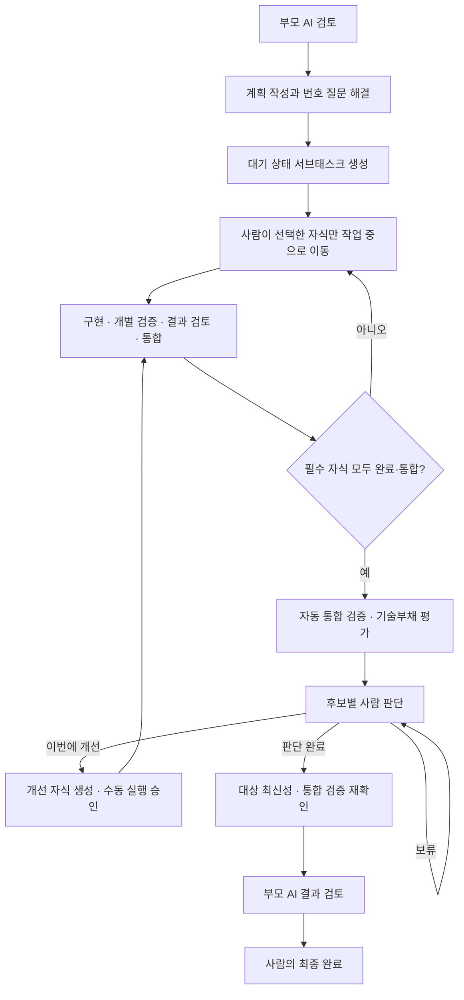

# GGJIRA — 서브태스크 실행과 완료 전 기술부채 평가

갱신일: 2026-10-21

상태: 생명주기 v2 구현 기준. 실제 Jira·AI CLI 연동 검증은 자동 테스트와 구분한다.

## 프로젝트 목적과 결정

GGJIRA는 Jira를 인간과 AI의 공용 작업 인터페이스로 쓰는 경량 오케스트레이션 시스템이다.
사람은 목적·범위·실행·잔여 부담에 책임지고, AI는 계획·구현·검증과 근거가 있는 개선 후보 발견을 맡는다.
Router만 Jira에 접근하고, Worker는 Router가 전달한 계약을 실행한다.

부모는 목적·전체 완료 조건·작업 목록·평가 결과를 관리한다. 부모 자체는 구현하지 않는다.
작은 요청도 서브태스크 1개로 처리하되, 개수가 아니라 독립적인 결과와 검증 경계로 분해한다.
별도의 부모 계획 승인과 부모의 ‘작업 중’ 전환은 없앤다. 유효한 계획을 게시하면 대기 상태의 자식을 생성하고,
사람이 각 자식을 ‘작업 중’으로 옮길 때 그 계약만 승인한다. 생성은 실행 승인이 아니다.

## 상태와 진행 흐름

부모는 평가와 개선이 끝날 때까지 `requestStatus`에 유지한다. 계획 작성·자식 대기·평가·판단·재확인은
Router 내부 단계로 표시한다. 새로운 필수 Jira 상태나 `planReviewStatus`를 추가하지 않는다.
부모의 관리 영역에는 짧은 진행 요약을 갱신하고 상세 작업은 자식과 근거 링크로 확인한다.
기술부채 판단 댓글은 부모나 자식을 자동으로 ‘작업 중’으로 옮기지 않는다.

## 실행 계약과 재계획

- 부모 계약: 전체 목표, 완료 조건, 통합 검증 방법, 공통 제약.
- 자식 계약: 목적, 범위·제외, 완료 조건, 검증 방법, 의존성, 변경 경로.
- 승인 기록: 계획 버전과 자식의 작업 중 진입 사건에 연결한다. 이전 계약의 승인을 재사용하지 않는다.
- 생성 복구: 보고 저널과 생성 마커로 부분 실패·응답 유실을 복구한다. 결과가 불명확한 생성은 자동 재전송하지 않는다.
- 자식이 하나도 시작되지 않았다면 요구사항 수정으로 자동 재계획한다.
- 자식 실행 후 부모 요구사항이 바뀌면 새 실행과 최종 전환을 보류한다. 실행 중 작업은 기존 계약으로 종료한다.
  종료 확인 후 담당자의 `재계획` 댓글로 새 작업 목록을 요청한다. 시작·완료한 작업은 명시적으로 보존한다.
- 계약을 바꾼 작업은 새 자식 계약으로 게시하고 새 수동 실행 승인을 받는다. 기존 결과나 완료 이슈를 덮어쓰지 않는다.

## 실제 통합과 고정된 평가 대상

v2는 Git 저장소부터 지원한다. 완료 상태나 F01 확인만으로 코드 통합을 추정하지 않는다.
최신 검토 결과의 head, PR 종료 시 head, 대상 브랜치와 실제 merge commit을 연결한다.
Squash·rebase merge도 원래 head 대신 실제 병합 커밋으로 의존성을 검증한다.

Worker는 대상 브랜치를 fetch하고, 필요한 병합 커밋이 해당 대상에 포함됐는지 확인한 뒤 별도 worktree를 만든다.
공유 checkout은 reset하지 않는다. Router와 Worker의 기준 브랜치 설정은 같아야 한다.
모든 필수 자식이 완료·통합되면 계획 버전·결과 집합·Git 커밋·정책 버전에 연결한 `quality_review`를 생성한다.
비 Git 또는 병합 근거가 없는 결과는 평가 통과로 처리하지 않는다.

검증 명령은 Worker의 신뢰된 `repository.validateCommand`에서만 실행한다. 계획의 검증 문장을 shell 명령으로
그대로 실행하지 않는다. 검증 명령이 없거나 실패하면 완료를 보류한다.
평가 Agent는 읽기 전용으로 실행하며 코드를 수정·커밋·push·merge하지 않는다. 수정은 별도 승인된 자식에서 수행한다.
평가 종료 시 변경 여부와 대상 최신성을 검사하고, 사람 판단이 끝나면 모델 호출 없이 검증·최신성을 다시 확인한다.
대상이 바뀌었거나 평가가 실패하면 담당자가 원인을 확인하고 `재시도` 댓글로 최신 평가를 요청한다.

## 기술부채와 후보 판단

평가 범위는 이번 변경과 직접 연결된 영역이다. 매번 저장소 전체의 정리를 요구하지 않는다.
후보에는 관찰 근거, 영향, 분류와 독립적으로 실행 가능한 개선 계약이 있어야 한다.
취향·파일 크기·자동 점수만으로 부채를 확정하지 않는다.

| 분류 | 처리 원칙 |
|---|---|
| 결함·미완료 | 요구사항 누락·버그·필수 검증 실패. 개선 또는 보류만 허용 |
| 신규 기술부채 | 이번 변경으로 생긴 유지보수 부담. 사람이 이번 개선·후속·수용을 판단 |
| 기존 기술부채 | 이번 결과와 직접 관련된 경우에만 연결 |
| 환경 장애 | 코드 부채와 구분하고 미검증으로 처리 |
| 근거 부족 | 추정을 사실로 확정하지 않고 보류·추가 확인 |

질문은 Jira에서 한 항목씩 순서대로 제시한다. 현재 부모 담당자의 해당 질문 이후 댓글만 처리한다.

| 번호 | 의미 | 결과 |
|---|---|---|
| 1 | 이번에 개선 | 제시된 계약으로 필수 개선 자식을 생성. 실행은 별도 수동 승인 |
| 2 | 후속 이관 | 사유 필수. 별도 이슈로 만들고 부모·근거·책임자를 연결 |
| 3 | 수용·기각 | 사유와 잔여 영향을 기록 |
| 4 | 보류 | 사유 필수. 같은 후보에서 판단 대기 |

예: `2 이번 릴리스 영향이 없어 후속 처리`. 2~4를 번호만 입력하면 사유를 추가로 묻는다.
결함·환경 장애·근거 부족은 2·3으로 통과시키지 않는다. 담당자가 바뀌면 이후 답변은 새 담당자 기준으로 검증한다.
후보 채택 전에는 티켓을 만들지 않는다. 개선·후속 이슈 생성과 원인·판단·소스 댓글은 복구 가능한 기록으로 남긴다.
`planning.followupIssueType`의 기본값은 `Task`이며 후속 이슈는 현재 부모의 필수 작업 수에서 제외한다.

## 종료 조건과 반복 제어

1. 계획의 필수 자식과 이번 개선으로 채택한 자식이 모두 완료·통합됐다.
2. 전체 요구사항과 신뢰된 통합 검증이 충족됐다.
3. 평가와 모든 후보 판단이 기록됐고, 보류나 필수 개선·불명확한 반영 결과가 없다.
4. 최종 검증 대상이 평가 대상과 일치한다.
5. Router가 부모를 결과 검토로 옮긴 뒤 사람이 최종 완료한다.

Agent 호출 성공과 품질 통과를 구분한다. 검증 실패나 미실행 평가를 ‘문제 없음’으로 표시하지 않는다.
개선 후에는 같은 부모 완료 절차 안에서 이전 지적과 영향받은 검증을 재확인한다.
개선 자식별로 새로운 전체 부채 평가를 재귀 생성하지 않는다. 이미 내린 판단은 후속 재확인에 전달한다.
평가·티켓·댓글은 재전송과 재시작에 중복되지 않도록 저널과 영속 식별자를 사용한다.
부모를 조기 수동 완료하면 Jira 상태는 존중하되, 품질 검증 완료로 기록하지 않고 주의 항목을 남긴다.

## 호환성과 전환

- migration 17은 기존 계획 요청을 v1로 유지한다. 새 요청부터 v2를 저장한다.
- 기존 활성 v1 계획은 부모 승인·직접 구현 또는 기존 자식 실행 방식으로 마무리한다.
- 완료 이슈에 평가를 소급 실행하거나 기존 작업을 자동 분해하지 않는다.
- 프로토콜 3의 `qualityContext`, `quality`, `integration` 계약을 사용하므로 Router와 Worker를 함께 업데이트한다.
- 배포 전 DB·설정을 백업하고 실행 중 호출·spool을 정리한다. 기존 업무 계획 전체를 취소할 필요는 없다.
- F03·F04의 근거·판단·후속 연결 방향을 완료 절차에 반영한다. F05 자동 분석이나 부채 점수는 추가하지 않는다.

참조: [ADR 0051](decisions/0051-child-approval-and-parent-quality-review.md), [아키텍처](architecture.md),
[운영 절차](runbook.md), [프로젝트 목적](../README.md).
