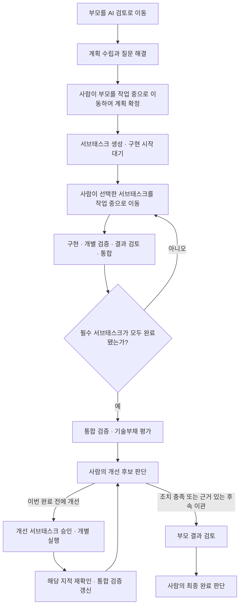

# GGJIRA 방향 정리 — 서브태스크 중심 실행과 완료 전 기술부채 평가

작성일: 2026-10-21

문서 상태: **후속 설계·구현을 위한 방향 정리안**

적용 대상: 부모 요구사항 태스크, 그 계획에서 생성된 서브태스크, 부모의 최종 완료 절차

> 이 문서는 현재 구현과 앞으로 바꿀 동작을 구분한다. 문서 작성만으로 기능이 구현되거나 운영 정책이 전환된 것은 아니다.
> 서브태스크 의무화·개별 실행·완료 전 기술부채 평가를 연결하고, 구체적인 API·DB·승인 UI는 구현 설계에서 확정한다.

## 1. 프로젝트 목적과 이번 방향

GGJIRA는 Jira를 인간과 AI가 함께 쓰는 작업 인터페이스로 삼는 **경량 오케스트레이션 시스템**이다.
사람은 목적과 범위를 정하고 계획·실행·결과에 책임지며, AI는 계획·구현·검증·개선 후보 발굴을 수행한다.
Router는 승인과 작업 배분, Jira 반영, 실행 기록과 복구를 관리하고, Worker는 받은 작업을 실행한다.

이번 방향의 목표는 작업을 많이 만드는 것이 아니라, **사람이 승인한 범위 안에서 검증 가능한 결과를 쌓고,
그 결과를 합친 뒤 남은 유지보수 부담을 확인하고 관리할 수 있게 하는 것**이다.

| 프로젝트 원칙 | 이번 방향에 적용하는 방식 |
|---|---|
| Jira가 인간·AI 공용 작업 인터페이스 | 실행할 작업·완료 조건·검토 결과를 서브태스크에서 확인 |
| 사람의 승인과 책임 유지 | 부모 계획 승인과 서브태스크별 구현 시작을 구분하고, 개선 후보는 사람이 채택 |
| 승인된 계획이 실행 계약 | 부모 목표와 각 작업의 범위·완료 조건·검증 방법을 계획 버전에 연결 |
| 작은 범위와 관찰 가능한 결과 | 작업 하나가 독립적으로 검증 가능한 결과 하나를 제공 |
| 경량 구조와 조작 최소화 | AI 전용 상태는 하나로 유지하고, 평가를 위한 새 서비스·필수 상태를 추가하지 않음 |
| 근거에 기반한 판단 | 코드·검증·변경 이력으로 부채를 제안하고, AI의 추정을 확정 사실과 구분 |
| 필요한 보고만 노출 | 부모 댓글은 짧게, 작업별 상세 내용은 서브태스크와 근거 링크로 제공 |

## 2. 현재 구현과 목표 동작

현재 구현은 저장소 코드와 ADR 0047·0050을 기준으로 확인했다. 아래 목표 동작은 후속 변경 사항이다.

| 항목 | 현재 구현 | 목표 동작 |
|---|---|---|
| AI 계획·질문·승인 대기 | 단일 `requestStatus`에서 진행 | 유지. 문서에서는 이 상태를 ‘AI 검토’로 표기 |
| 작은 요구사항 | 서브태스크 없이 부모를 직접 구현할 수 있음 | 실행 단위는 반드시 서브태스크. 작은 요구사항은 1개 생성 |
| 서브태스크 생성 | 계획 적용 시 생성되어 사람 승인보다 앞설 수 있음 | 사람이 부모 계획을 확정한 뒤 생성 |
| 부모 승인 효과 | 하위 작업들을 자동으로 작업 중으로 이동 | 작업 목록을 확정·생성하되, 구현은 시작하지 않음 |
| 서브태스크 실행 | 부모 승인에 따른 자동 전이로 시작 가능 | 사람이 해당 서브태스크를 작업 중으로 옮긴 경우에만 시작 |
| 전체 작업 종료 | 하위 작업들이 완료 조건을 충족하면 부모를 결과 검토로 이동 | 통합 검증·기술부채 평가·판단 및 필요한 개선을 거친 뒤 이동 |
| 기술부채 관리 | F03·F04에 후보 기록·후속 티켓 연결이 계획되어 있음 | 부모 완료 절차와 연결하되, 모든 후보를 자동 티켓화하지 않음 |

‘AI 검토’는 설정된 Jira 상태의 역할 이름이다. 운영 환경에서 기존 ‘AI 계획 검토’를 같은 역할로 사용해도 된다.
부모·서브태스크는 Jira 업무 이슈이며, 내부 job·attempt와 구별한다.

## 3. 부모와 서브태스크의 책임

### 부모 태스크: 목적·계획·전체 결과 관리

부모는 원래 요구사항, 전체 완료 조건, 공통 설계 결정, 작업 목록과 의존성을 관리한다.
직접 코드를 구현하지 않으며, 모든 하위 결과를 합쳤을 때 요구사항을 충족하는지 확인한다.
기술부채 평가와 사람이 내린 처리 판단도 부모에서 추적한다.

부모 댓글은 다음 항목으로 제한한다. 상세 실행 로그나 전체 계획 본문을 매번 반복하지 않는다.

- 계획 목적과 주요 결정의 짧은 요약.
- 확정할 작업 목록과 의존성. 생성 후에는 각 서브태스크 링크.
- 현재 필요한 사람 행동: 계획 승인, 선택지 답변, 개선 후보 판단, 최종 결과 검토.
- 완료 전 평가 결과 요약과 근거·개선 작업 링크.

### 서브태스크: 구현·검증·검토의 실행 단위

코드나 산출물을 바꾸는 작업은 모두 서브태스크로 표현한다. 기술부채 개선 작업도 같은 규칙을 따른다.
계획에서 승인된 서브태스크는 부모의 맥락과 자신의 계약을 받아 구현하며, 다시 계획 작업으로 재귀 분해하지 않는다.
추가 분해나 범위 변경이 필요하면 부모의 재계획으로 돌린다. Jira 서브태스크 아래에 다시 서브태스크를 만들지 않는다.

각 작업에는 다음 정보가 필요하다.

| 필드 | 담아야 할 내용 |
|---|---|
| 목적 | 무엇이 달라지고 왜 필요한지 |
| 범위 | 포함·제외할 동작, 공통 규약과 제약 |
| 완료 조건 | 사람이 확인할 수 있는 결과 |
| 검증 방법 | 완료 조건을 확인할 테스트·명령·관찰 방법 |
| 의존성 | 먼저 완료·통합되어야 하는 작업과 필요한 산출물 |
| 연결 정보 | 부모, 승인된 계획 버전, 책임자, 실행 결과·PR·검증 근거 |

작업 수의 최소값은 1개이며, 여러 개를 만들기 위한 인위적인 분해는 하지 않는다.
예를 들어 문구 변경은 서브태스크 1개면 충분하다. 파일별 편집이나 ‘코드 작성 → 테스트 작성 → 보고’ 같은
작업 절차를 기계적으로 티켓으로 나누지 않는다. 여러 작업으로 나눌 때는 각각의 결과와 검토 경계가 설명되어야 한다.

## 4. 계획 확정과 개별 구현 흐름

- **계획 확정**은 미해결 선택지가 없고 작업 계약이 유효한 최신 계획을 사람이 승인한 사건이다.
  AI가 계획 생성을 끝냈다는 사실만으로 확정하지 않는다.
- 부모의 AI 검토 → 작업 중 이동은 계획 승인이다. 부모나 하위 작업의 구현을 일괄 시작하는 승인이 아니다.
- 계획 확정 전에는 작업 목록을 제안 형태로 보여 주고, 확정 후 Router가 Jira 서브태스크를 생성한다.
  따라서 현재처럼 ‘서브태스크 생성까지 끝나야 계획이 승인 가능’한 준비 조건도 함께 바꿔야 한다.
- 생성이 일부만 성공하면 미완료 생성부터 복구한다. 작업 목록 반영이 끝나기 전에는 해당 계획의 구현을 시작하지 않는다.
  중복 생성과 결과가 불명확한 Jira 쓰기는 기존 보고 저널의 복구 원칙을 따른다.
- 서브태스크의 할 일 → 작업 중 이동은 해당 작업의 구현 요청이다. Router가 만든 작업이고, 유효한 부모 계획에
  속하며, 책임자·의존성·입력 조건을 만족할 때만 실행한다. 일반적인 사람 작업을 AI 작업으로 추정하지 않는다.
- 의존성이 부족하면 실행을 보류하고 이유를 표시한다. 작업 중이라는 Jira 상태와 실제 Worker 실행 중 여부를 구분한다.
- 재계획 시 완료·실행 중인 작업을 자동 삭제하거나 덮어쓰지 않는다. 유지·수정·제외 대상과 이미 발생한 변경을
  구분하고, 바뀐 계약은 새 승인을 받는다. 오래된 승인과 늦은 결과는 새 계획에 적용하지 않는다.

## 5. 부모 완료 전 평가를 시작하는 조건

평가는 **모든 필수 서브태스크의 결과가 검토·통합된 뒤, 부모를 결과 검토·완료로 넘기기 전에** 수행한다.
현재 하위 작업 완료 감지 경로를 이 평가의 진입점으로 바꾸되, 평가 성공을 부모 완료로 곧바로 해석하지 않는다.

‘하위 작업 완료’는 Agent의 성공 보고나 상태 문자열 하나로 판단하지 않는다. 필수 검증과 결과 검토가 끝났으며,
부모 평가에서 사용할 수 있는 산출물이 있어야 한다. 계획에서 제외한 작업은 그 근거와 승인 이력을 남긴다.

Git 작업의 기본 평가 대상은 관련 PR들이 통합된 **하나의 기준 커밋**이다. 후속 작업에 선행 코드가 필요한 경우도
우선 선행 PR 병합과 해당 커밋의 로컬 반영을 확인한 뒤 실행한다. 현재의 F01 ‘확인’만으로 코드가 통합됐다고 보지 않는다.
이 조건을 만들지 않고 작업을 나누면, 서로 다른 브랜치에서 각자 통과한 결과를 전체 성공으로 오인할 수 있다.

비Git 저장소는 파일·산출물 스냅샷과 검증 근거로 평가 대상을 고정한다. 대상을 고정할 수 없거나 기록이 부족하면
‘미검증’으로 보류하며, 커밋이 없다는 사실을 숨기지 않는다. 해당 저장소의 기존 동시 실행 제한을 유지한다.

평가 식별에는 부모, 계획 버전, 하위 결과 집합, 기준 커밋 또는 산출물 스냅샷, 평가 정책 버전을 연결한다.
이 중 평가 대상이 바뀌면 기존 결과는 이력으로 보존하고 최신성 확인 또는 갱신이 필요하다.

## 6. 통합 검증과 기술부채 평가의 내용

통합 검증은 원래 요구사항이 실제로 동작하는지 확인한다. 기술부채 평가는 그 결과가 향후 변경·운영에 남기는
부담을 관찰한다. 두 작업은 같은 완료 절차에 속하지만, 검증 실패를 기술부채라는 이름으로 넘기지 않는다.

| 확인 영역 | 질문 예시 |
|---|---|
| 전체 요구사항 | 개별 작업이 통과했어도 빠진 사용자 흐름이나 연결 동작이 있는가? |
| 경계·규약 | 작업 사이 API·데이터 모델·오류 처리·권한 규칙이 일관되는가? |
| 중복·결합 | 같은 정책이 중복되거나 한 변경이 불필요하게 많은 영역을 함께 바꾸게 하는가? |
| 임시 처리 | 우회·하드코딩·임시 호환 코드의 이유와 제거 조건이 분명한가? |
| 검증 가능성 | 중요한 동작을 확인할 수 있으며, 회귀를 탐지할 근거가 있는가? |
| 운영 가능성 | 실패 원인과 복구 행동을 로그·결과·문서로 확인할 수 있는가? |

기본 범위는 이번 변경과 그 주변의 직접적인 연관 영역이다. 저장소 전체를 매번 리팩터링 대상으로 삼지 않는다.
기존 부채도 이번 작업으로 악화됐거나 이번 결과의 유지보수에 직접 영향을 주는 경우에 연결한다.
취향 차이, 파일 수, 작업 시간, 토큰 소비량만으로 부채를 확정하지 않는다.

평가 결과는 다음과 같이 분류한다.

| 분류 | 의미와 처리 |
|---|---|
| 미완료·결함 | 요구사항 미충족, 버그, 필수 검증 실패. 원래 작업을 수정하거나 보완 작업으로 처리하며 완료 전에 해결 |
| 이번 변경의 부채 후보 | 동작은 충족하지만 향후 변경·운영 부담의 근거가 있음. 사람이 이번 개선 또는 후속 관리 여부를 판단 |
| 기존·장기 부채 후보 | 현재 범위를 넘는 구조 개선. 별도 후속 관리 대상으로 검토하며 자동으로 부모 완료를 막지 않음 |
| 환경·도구 장애 | 테스트 환경, CLI, 네트워크 등 실행 문제. 평가·검증의 제한으로 기록하고 코드 부채와 분리 |
| 근거 부족·미확인 | 판단할 자료가 부족함. 무부채나 통과로 표시하지 않고 추가 확인 대상으로 남김 |

후보마다 코드·산출물 위치, 관찰 사실과 근거 링크, 예상 영향, 이번 변경과의 관계, 개선안, 검증 방법,
책임자와 채택 상태를 기록한다. ‘구조가 복잡하다’ 같은 평가 문장만으로 티켓을 만들지 않는다.

## 7. 평가 결과에서 개선 작업으로 연결

평가 자체는 자동으로 수행하되, AI가 발견한 것은 **후보**이며 사람이 채택하기 전에는 확정 부채가 아니다.
단일 점수나 AI의 심각도 판단만으로 자동 실행·완료 승인을 결정하지 않는다.

| 사람의 판단 | 후속 처리 | 부모 완료에 미치는 영향 |
|---|---|---|
| 이번 완료 전에 개선 | 같은 부모 아래 개선 서브태스크 생성. 범위·완료 조건을 승인하고 해당 작업을 수동으로 시작 | 개선·재검증 전에는 완료 불가 |
| 후속 작업으로 이관 | 별도 후속 이슈를 생성하거나 기존 이슈에 연결. 책임자·남은 영향·미루는 이유 기록 | 미완료·결함이 아니고 사람이 잔여 영향을 수용한 경우 최종 검토 가능 |
| 기각·수용 | 오탐·중복·현재 조건에서 수용 가능한 부담이라는 이유를 기록 | 필수 검증과 나머지 판단이 충족되면 최종 검토 가능 |
| 판단 보류 | 필요한 정보나 의사결정을 명시 | 해당 평가의 판단이 끝나지 않았으므로 최종 완료 보류 |

별도 후속 이슈로 이관한 작업은 현재 부모의 필수 서브태스크 목록에 넣지 않는다. 이번에 끝낼 작업과 후속 과제를
혼동하지 않도록 링크로 추적한다. 요구사항 미충족이나 필수 검증 실패를 후속 부채로 바꿔 완료를 우회하지 않는다.

평가 Agent가 직접 코드를 수정하거나 개선 티켓을 자동 실행하지 않는다. 사람에게 채택된 개선 작업은
같은 Worker 실행·범위 계약·결과 검토 절차를 따른다. 기존 기능 작업이 아닌 추가 범위라는 사실도 승인에 남긴다.

후보가 없으면 ‘확인한 범위에서 추가 후보 없음’이라는 짧은 결과만 남긴다. 저장소 전체에 부채가 없다는 뜻으로
표현하지 않으며, 빈 개선 티켓이나 장문의 부채 보고서를 만들지 않는다.

## 8. 종료 조건과 반복 제어

부모의 최종 검토에는 다음 조건을 함께 적용한다.

1. 승인된 계획의 필수 기능 작업과 이번 완료 전에 하기로 채택한 개선 작업이 모두 완료·통합됐다.
2. 현재 기준 커밋·산출물에 대해 전체 요구사항과 필수 통합 검증이 충족됐다.
3. 해당 대상의 기술부채 평가가 끝났고, 발견 후보에 대한 사람의 판단과 잔여 영향이 기록됐다.
4. 보류 중인 판단, 필수 검증의 실패·미검증, 불명확한 실행·반영 결과가 없다.
5. 사람이 부모 전체 결과를 최종 검토한다. Agent 성공·평가 통과만으로 Done이나 PR merge를 만들지 않는다.

같은 평가 대상·정책에는 평가를 중복 실행하지 않는다. 개선 후에는 해당 지적과 영향을 받은 통합 검증을 우선
재확인하고, 변경 범위가 넓어진 경우 관련 평가 범위를 갱신한다. 새 코드에 이전 평가를 그대로 붙여 통과시키지 않는다.

모든 개선 서브태스크가 끝날 때마다 독립적인 전체 부채 평가를 재귀적으로 생성하지 않는다. 최초 평가와
재확인을 부모의 같은 완료 절차로 묶고, 범위 확대나 새 발견은 사람이 이번 처리·후속 이관을 다시 판단한다.
완벽한 무부채 상태가 아니라 **합의된 품질과 잔여 부담을 설명할 수 있는 완료**를 목표로 한다.

## 9. 구조·비용·보고 원칙

- Router만 Jira를 읽고 쓴다. 평가 자료 수집·작업 배정·결과 저장·티켓 연결·중복 억제도 Router 책임이다.
- Worker는 고정된 평가 대상과 기존 결과를 받아 검증·분석한다. 평가 Agent는 코드를 변경하지 않는다.
  실제 개선은 별도로 승인된 서브태스크에서만 수행한다.
- 평가 진행·판단 대기·재확인은 Router 내부 단계로 표시한다. 별도 ‘AI 부채 평가’ Jira 상태를 필수로 추가하지 않는다.
  부모는 작업 중을 유지하다 완료 전 조건이 충족되면 결과 검토로 이동한다. 최종 완료는 기존 완료 정책을 따른다.
- 기존 실행에서 얻은 diff·검증·실패·사용량·부채 후보를 재사용한다. 부모의 통합 결과를 보는 별도 평가가 필요하면
  이를 명시적인 평가 실행으로 기록한다. 보고 문장 작성이나 화면 갱신을 위한 LLM 호출은 추가하지 않는다.
- 평가는 부모·기준 커밋 단위로 중복 억제한다. 실패·재시도·미완료 평가의 사용량도 원래 부모에 연결해 보존한다.
- 같은 원인의 부채 후보·개선 티켓은 중복을 합치고, 해소·재발 이력을 연결한다. 평가 실패를 ‘문제 없음’으로 처리하지 않는다.
- 새 서비스·자동 부채 점수·무인 승인·자동 merge를 이번 방향에 끼워 넣지 않는다.

## 10. 기존 문서와의 관계 및 구현 순서

기존 결정을 즉시 삭제하거나 현재 기능을 완료로 간주하지 않는다. 구현 시 다음 변경 범위를 새 ADR과 검증 기록에 남긴다.

| 기존 기준 | 유지할 내용 | 변경·확장할 내용 |
|---|---|---|
| ADR 0047: 계획이 실행 계약 | 설명 키워드 파싱 없이 승인된 계획에서 계약을 읽음 | 부모 직접 구현 경로를 없애고 실행 계약을 서브태스크에 일관되게 배치 |
| ADR 0050: 단일 AI 검토 | 번호 답변·수정·재시도, 수동 상태 이동 승인 | 부모 승인은 작업 목록 확정, 서브태스크 이동은 개별 실행 요청으로 역할 분리 |
| F01: 검토 기록 | 결과·승인·커밋에 연결한 확인과 오래된 검토 거절 | ‘확인’과 실제 코드 통합 여부를 구분하여 후속 실행·부모 평가에 반영 |
| F03: 부채 후보 기록 | 관찰·근거·영향·책임자·채택 상태, 중복 관리 | 부모 완료 전의 평가·판단과 연결 |
| F04: 후속 티켓 연결 | 사람 채택 후 Router가 생성하거나 기존 이슈 연결 | 이번 개선 서브태스크와 별도 후속 이관을 구분 |
| F05: 비교·분석 | 원래 요구사항 단위 사용량과 재작업 원인 기록 | 후속 분석으로 유지. 자동 부채 점수나 완료 차단 기준으로 앞당기지 않음 |
| 기존 LLM 호출 최소화 원칙 | 실행 결과·후보 재사용, 보고용 추가 호출 금지 | 완료 시 통합 결과를 확인하는 별도 평가 실행을 명시적으로 허용하는 설계 변경 필요 |

권장 구현 순서는 다음과 같다. 각 단계는 독립적인 검증 가능한 결과로 나눈다.

1. **부모·서브태스크 실행 모델 정리:** 서브태스크 최소 1개, 부모 직접 구현 제거, 계획 확정 후 생성과 생성 복구.
2. **개별 실행과 의존성 정리:** 자동 일괄 시작 제거, 작업별 수동 시작, 선행 결과의 실제 통합·로컬 반영 확인.
3. **부모 완료 절차 도입:** 하위 완료 감지에서 곧바로 결과 검토로 가지 않고, 고정된 대상의 통합 검증·평가로 연결.
4. **후보 판단과 개선 연결:** F03·F04를 사용해 채택·기각·후속 이관, 개선 서브태스크와 재확인 이력 관리.
5. **전환과 운영 검증:** 기존 부모 직접 구현·자동 하위 실행 기록의 처리, DB·설정 백업, 진행 중 작업 보존과 복구 확인.

기존 작업을 업그레이드 과정에서 자동 분해하거나, 완료 이슈에 새 평가를 소급 실행하지 않는다.
새 정책의 적용 기준선과 기존 활성 계획의 유지·전환 방식은 구현 착수 전에 정해야 한다.

## 11. 인수 기준과 참조

- 작은 요구사항에도 서브태스크 1개가 생기며 부모 자체의 구현 job은 생기지 않는다.
- 계획 확정 전에는 제안만 있고, 확정 후 생성은 부분 실패·재시작·재전송에도 중복되지 않는다.
- 부모 승인만으로 어떤 서브태스크도 구현을 시작하지 않는다. 사람이 선택한 유효 작업만 실행된다.
- 의존 작업은 필요한 코드·산출물이 실제로 준비되기 전에는 실행되지 않는다.
- 모든 필수 서브태스크가 끝나면 부모 평가를 정확히 한 번 시작하고, 평가 대상이 바뀌면 최신성을 다시 확인한다.
- 검증 실패·환경 장애·코드 부채·근거 부족을 구분하며, 실패하거나 미실행한 평가를 통과로 표시하지 않는다.
- 후보는 사람이 채택하기 전 자동 티켓화·자동 실행되지 않는다. 채택된 개선도 개별 실행 승인을 따른다.
- 필수 개선·통합 검증·사람의 후보 판단이 끝나기 전에는 부모를 최종 완료로 처리하지 않는다.
- 후속 이관한 부채는 원래 작업·근거·책임자와 연결되고, 현재 부모의 필수 작업으로 잘못 집계되지 않는다.
- 재평가 루프, 오래된 승인·결과·커밋의 재사용, 중복 댓글·티켓·사용량 집계가 발생하지 않는다.
- 자동 검증은 Fake Jira·Fake Worker·임시 DB를 사용한다. 실제 Jira 상태·PR 병합·Worker 연동은 별도 수동 검증으로 기록한다.

참조 자료:

- [프로젝트 목적과 현재 사용 흐름](../README.md)
- [현재 아키텍처와 역할 분리](architecture.md)
- [승인된 계획을 실행 계약으로 사용 — ADR 0047](decisions/0047-single-workflow-and-plan-as-contract.md)
- [단일 AI 검토와 댓글로 계획 이어가기 — ADR 0050](decisions/0050-single-ai-review-and-comment-continuation.md)
- [M4 후속 백로그 — F03·F04·F05](M4_WORK_BACKLOG.md)
- [기술부채 증거와 LLM 호출 최소화 원칙](CLAUDE_CODE_IMPLEMENTATION_TASKS.md)
