# GGJIRA 사용자 매뉴얼

Jira 이슈를 AI에게 맡기고, 사람은 **승인**과 **결과 확인**만 하는 방법을 설명한다.
설치와 운영은 [README](../README.md)와 [runbook](./runbook.md)을 본다. 이 문서는 Router와 Worker가 이미
떠 있고 Jira 프로젝트가 연결된 상태에서 시작한다.

## 한눈에 보기

사람이 하는 일은 네 가지다.

1. 이슈를 만들고 **AI 계획**으로 옮긴다.
2. AI가 만든 계획을 읽고, 실행할 하위 작업을 **AI 구현**으로 옮긴다.
3. GitHub에서 AI가 만든 PR을 검토하고 병합한다.
4. 결과를 확인하고 **Done**으로 옮긴다.

나머지 상태 이동은 GGJIRA가 한다.

| 보드 열 | 누가 옮기나 | 뜻 |
|---|---|---|
| 해야 할 일 | 사람 | 아직 AI에게 맡기지 않은 이슈 |
| AI 계획 | **사람** | 계획을 부탁한 이슈. 워커가 비면 시작한다 |
| AI 계획중 | GGJIRA | AI가 계획을 세우는 중이거나, 계획이 끝나 승인을 기다리는 중 |
| AI 구현 | **사람**(하위 작업) / GGJIRA(부모) | 사람이 승인한 작업을 AI가 구현하는 중 |
| AI 통합 대기 | GGJIRA | 부모 PR이 만들어져 사람의 병합을 기다리는 중 |
| AI 구현 완료 | GGJIRA | 하위 작업은 구현·검증 끝, 부모는 병합 후 통합 검증까지 끝 |
| Done | **사람** | 사람이 최종 확인한 이슈 |

- GGJIRA는 이슈 **담당자(Assignee)** 를 결과 책임자로 본다. 담당자가 없는 이슈는 시작하지 않는다.
  AI 질문에 답하거나 `재시도`를 요청할 수 있는 사람도 담당자뿐이다. AI는 담당자를 바꾸지 않는다.
- 진행 상황은 Jira 댓글과 Router 웹 UI(`https://<Router 주소>/ui/`)의 **대시보드**에서 본다.

## 따라 해 보기: 기능 하나를 AI에게 맡기기

예제 저장소 [gg-repo](https://github.com/hokim84/gg-repo)는 텍스트 파일의 줄·단어·문자 수를 세는 작은
Python 도구다. 여기에 "가장 많이 나온 단어 N개 보기" 기능을 AI에게 맡겨 본다. 아래 화면은 GGJIRA 테스트
프로젝트(KAN)에서 이 시나리오를 실제로 실행하며 찍었다. 계획 2분, 하위 작업마다 3~5분이 걸렸다.
도중에 통합 검증이 한 번 실패해 고친 과정도 [실제 사례](#실제-사례-통합-검증-실패에서-복구하기)로 남겼다.

### 1단계. 이슈 만들기 — 사람

Jira에서 평소처럼 이슈를 만든다. 유형은 Feature·작업 등 무엇이든 된다. **담당자**를 꼭 지정한다.

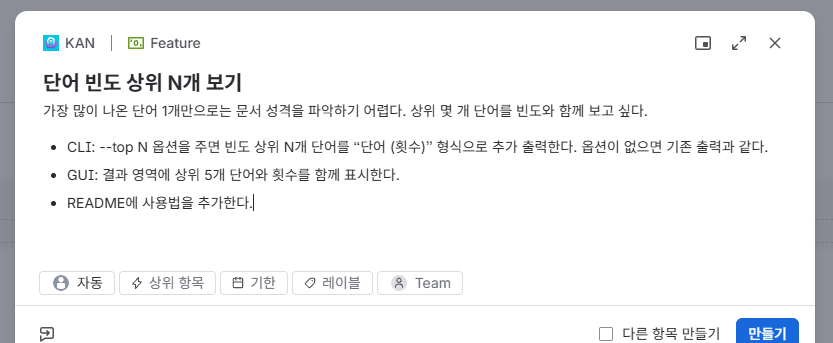

설명에는 AI가 알아야 할 것을 적는다.

- **왜** 필요한지(예: "가장 많이 나온 단어 1개만으로는 문서 성격을 알기 어렵다")
- **무엇이 되면 끝인지**(예: "`--top N` 옵션을 주면 상위 N개를 `단어 (횟수)` 형식으로 출력한다")
- **바뀌면 안 되는 것**(예: "옵션이 없으면 기존 출력과 같다")

구현 방법까지 적을 필요는 없다. AI가 저장소를 읽고 계획을 세운다.

### 2단계. "AI 계획"으로 옮기기 — 사람

이슈 오른쪽 위의 상태 버튼을 눌러 **AI 계획**을 고른다. 보드에서 카드를 **AI 계획** 열로 끌어도 된다.

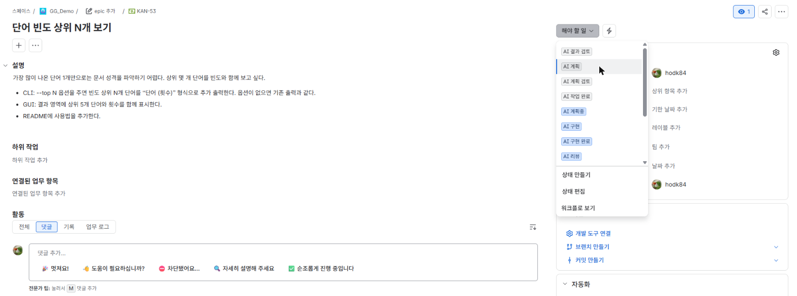

> 이 테스트 프로젝트에는 이전 버전에서 쓰던 상태(AI 결과 검토, AI 계획 검토, AI 작업 완료, AI 리뷰 등)가
> 남아 있어 목록이 길다. 지금 GGJIRA가 쓰는 상태는 [한눈에 보기](#한눈에-보기)의 표에 있는 것뿐이다.

### 3단계. AI가 계획을 세운다 — 자동

워커가 작업을 받으면 이슈가 **AI 계획중**으로 바뀌고 "계획 실행을 시작합니다" 댓글이 달린다.
Router가 Jira 웹훅을 받으면 바로, 웹훅이 없으면 1분 안에 시작한다.

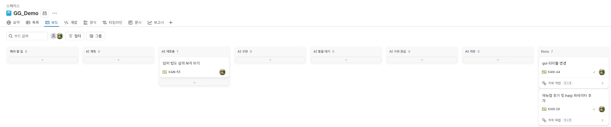

Router 웹 UI의 **대시보드**에서 이슈를 누르면 지금 무엇을 하는지와 **다음 할 일**이 보인다.

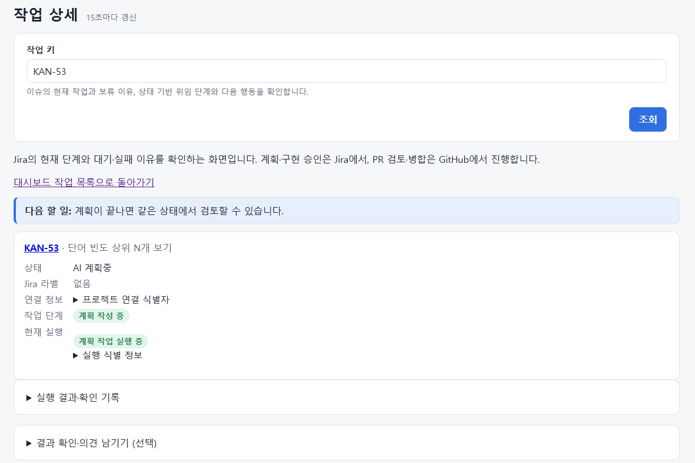

### 4단계. 계획과 하위 작업 읽기 — 사람

계획이 끝나면 세 가지가 생긴다. 이슈는 **AI 계획중**에 그대로 남는다.

1. **설명 아래의 계획.** `[GGJIRA:PLAN:START]`부터 `[GGJIRA:PLAN:END]`까지가 AI가 쓴 계획이다. 목표,
   완료 조건(Acceptance Criteria), 검증 방법(Verification), 하는 일과 하지 않는 일(In/Out of Scope)이 있다.

   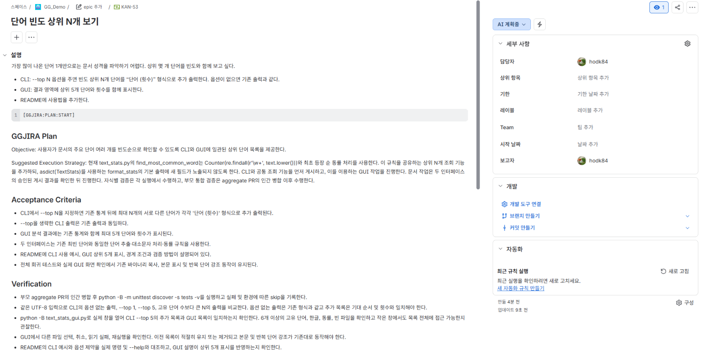

2. **하위 작업.** 계획을 실행 단위로 나눈 것이다. 이번에는 CLI(KAN-54), GUI(KAN-55), README(KAN-56)
   세 개가 생겼다. 하위 작업마다 자기 설명에 같은 형식의 계획이 들어 있다.

   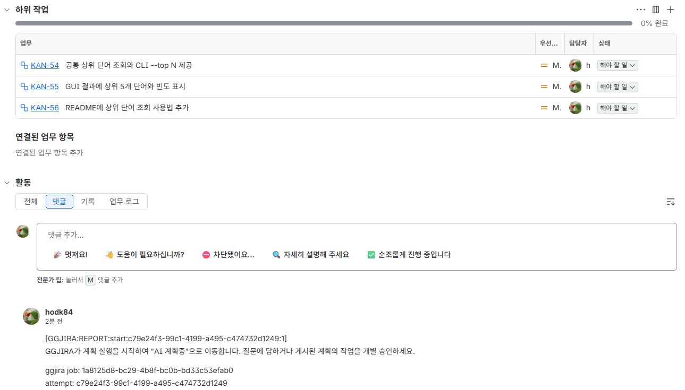

3. **"계획을 반영했습니다" 댓글.** 요약과 만든 하위 작업 목록, 다음에 할 일을 알려 준다.

   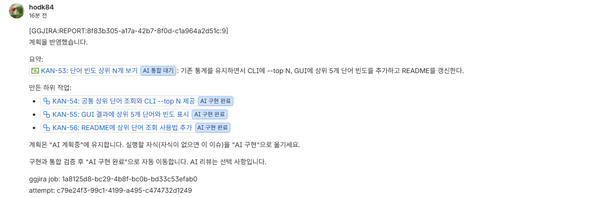

계획이 마음에 들지 않으면 [계획을 고치고 싶을 때](#계획을-고치고-싶을-때)를 본다. AI가 질문을 남겼다면
[AI가 질문할 때](#ai가-질문할-때)를 본다.

### 5단계. 하위 작업 승인하기 — 사람

실행할 하위 작업을 **AI 구현**으로 옮긴다. 이것이 "이 계약대로 구현해도 된다"는 승인이다.
하위 작업을 열어 상태 버튼으로 옮겨도 되고, 보드의 부모 카드에서 **하위 작업**을 펼쳐 카드의 상태
드롭다운으로 옮겨도 된다.

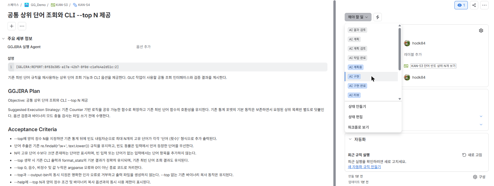

- 하위 작업은 **하나씩** 승인한다. 승인하지 않은 하위 작업은 실행하지 않는다.
- 첫 하위 작업이 시작되면 부모도 **AI 구현**으로 바뀐다. 부모는 직접 옮기지 않는다.
- 여러 개를 한꺼번에 승인해도 된다. 계획에 순서가 있으면 앞 작업이 끝날 때까지 뒤 작업은 기다린다.
  뒤 작업은 앞 작업의 결과 커밋을 이어받아 시작하며, PR 병합을 기다리지 않는다.

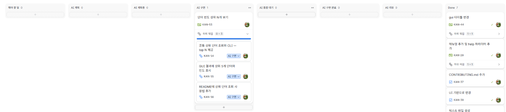

이번에는 세 개를 모두 승인했다. 대시보드를 보면 KAN-54가 실행 중이고 GUI·README 작업은 KAN-54를 기다린다.

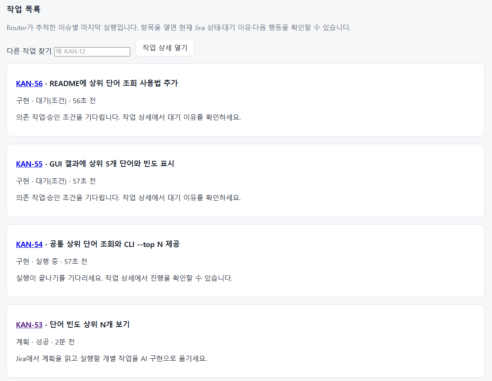

### 6단계. AI가 구현하고 검증한다 — 자동

워커가 하위 작업마다 별도 작업 공간에서 구현하고, AI와 별개로 저장소의 검증 명령(이 저장소는
`python3 -m unittest`)을 직접 실행한다. 통과하면 결과 커밋을 원격 브랜치에 올리고 하위 작업을
**AI 구현 완료**로 옮긴다. 결과는 댓글로 남는다.

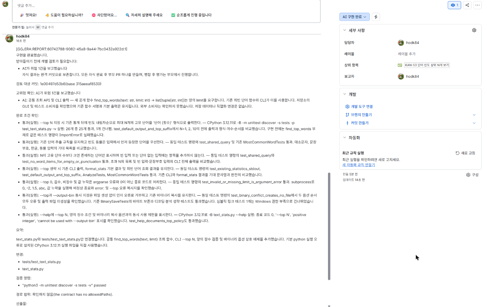

댓글에서 볼 곳은 다음과 같다.

- **완료 조건 확인:** 완료 조건마다 `통과(실행)`·`통과(코드 확인)`·`미검증`·`실패`로 표시한다. `실행`은 AI가
  직접 돌려 봤다는 뜻, `코드 확인`은 코드만 읽고 판단했다는 뜻이다. 이 구분은 AI의 자기 보고다.
- **검증 명령:** 워커가 직접 실행한 결과다. GGJIRA가 스스로 만드는 증거는 이것뿐이다. 통과하면 명령의 마지막
  출력 줄(예: `OK (skipped=1)`)이 함께 보이니, 건너뛴 테스트가 있는지 여기서 본다.
- **받아들이기 전에 개별 검토가 필요합니다:** AI가 위험을 보고했거나 확인하지 못한 조건이 있으면 붙는다.
  막는 표시가 아니라 PR을 볼 때 눈여겨보라는 표시다. 대시보드의 **확인 필요 항목**에도 올라간다.

하위 작업마다 PR을 따로 만들지 않는다. PR은 모든 하위 작업이 끝난 뒤 부모에 하나만 만든다.

### 7단계. AI가 확인하지 못한 조건 확인하기 — 사람, 있을 때만

화면을 직접 봐야 하는 조건처럼 AI가 확인할 수 없는 것은 AI가 `미검증`으로 보고한다. 이번에는 GUI 작업
(KAN-55)의 "목록 전체를 창 크기 변경이나 스크롤로 볼 수 있다"가 그랬다. 이때 하위 작업은 실패하지 않고
**AI 구현 완료**로 가며, **사람 확인 필요** 댓글이 달린다.

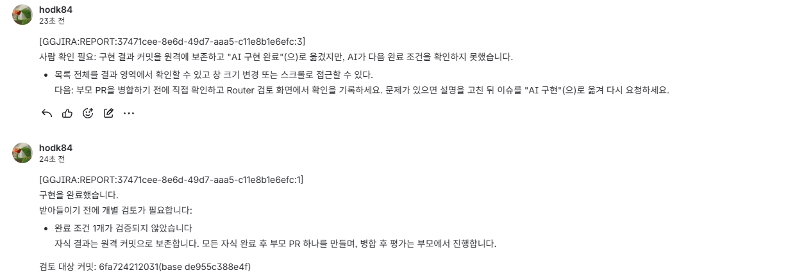

부모 PR을 병합하기 **전에** 그 조건을 직접 확인한다(이번 예라면 PR 브랜치에서 GUI를 띄워 본다).

- 문제가 없으면 Router 웹 UI의 작업 상세에서 **결과 확인·의견 남기기 → 결과 확인 기록**을 누른다.
  확인 댓글이 달리고 확인 필요 항목이 정리된다. 기록하지 않아도 진행은 막히지 않는다.
- 문제가 있으면 하위 작업 설명을 고친 뒤 **AI 구현**으로 다시 옮긴다. 그 하위 작업만 다시 구현한다.

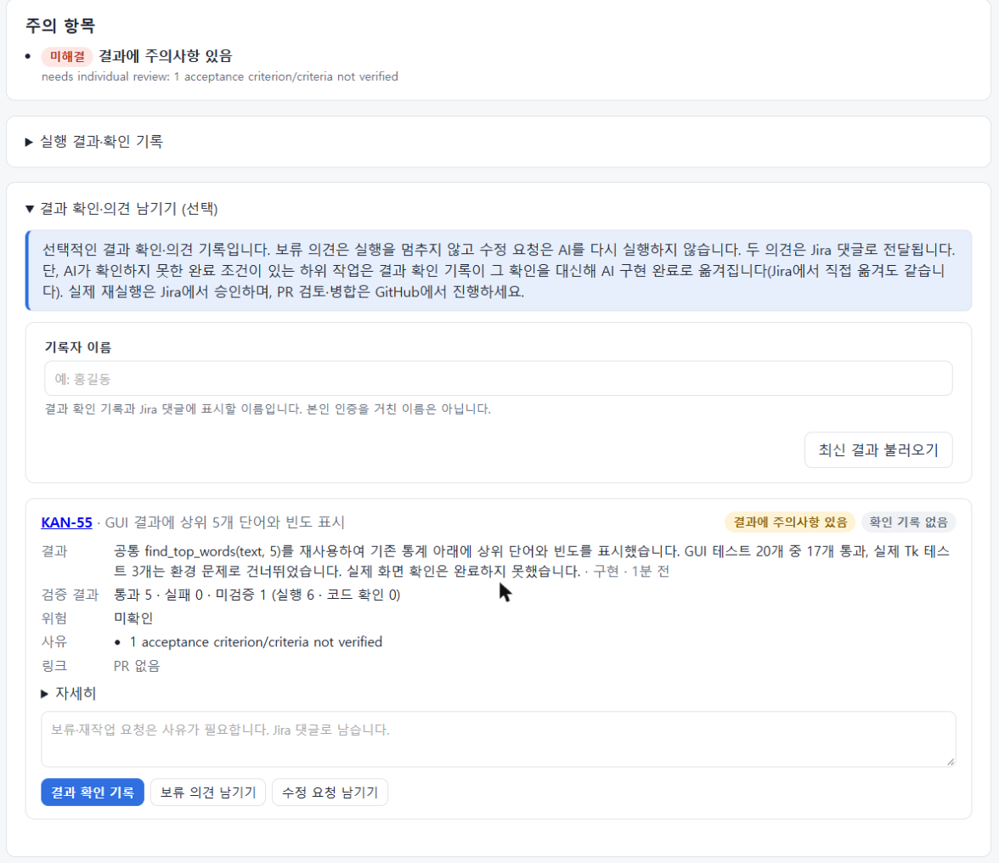

검증 명령이나 완료 조건이 **실패**한 경우는 다르다. 그때는 하위 작업이 실패로 남는다([실패했을 때](#실패했을-때)).

### 8단계. 부모 PR 검토하고 병합하기 — 사람

모든 하위 작업이 **AI 구현 완료**가 되면 GGJIRA가 하위 작업 결과를 모아 부모 PR 하나를 만들고, 부모를
**AI 통합 대기**로 옮긴다.

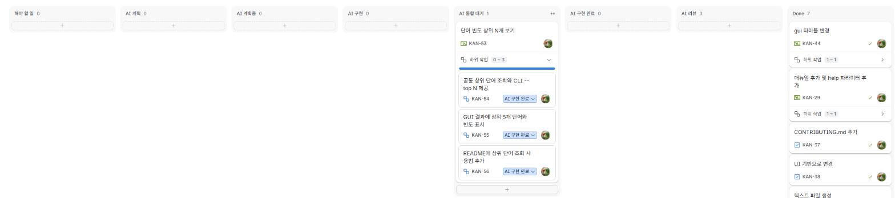

부모 이슈의 댓글에 PR 링크가 있다.

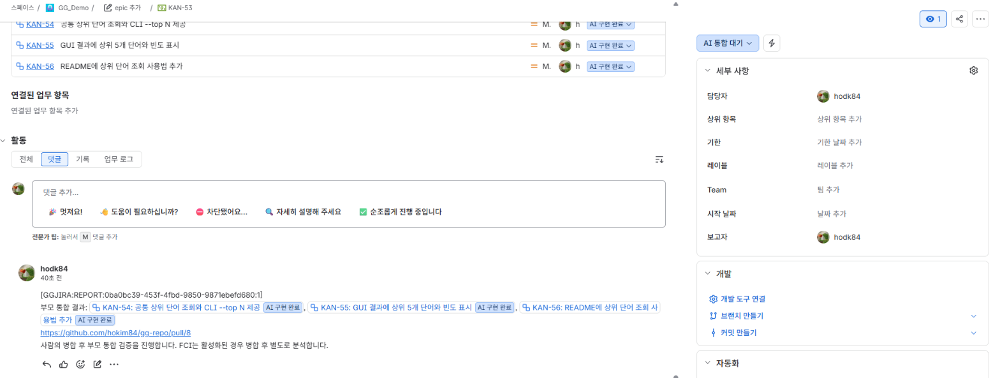

GitHub에서 PR을 열어 평소처럼 변경을 검토하고 병합한다. 7단계에서 확인할 것이 있었다면 병합 전에 끝낸다.

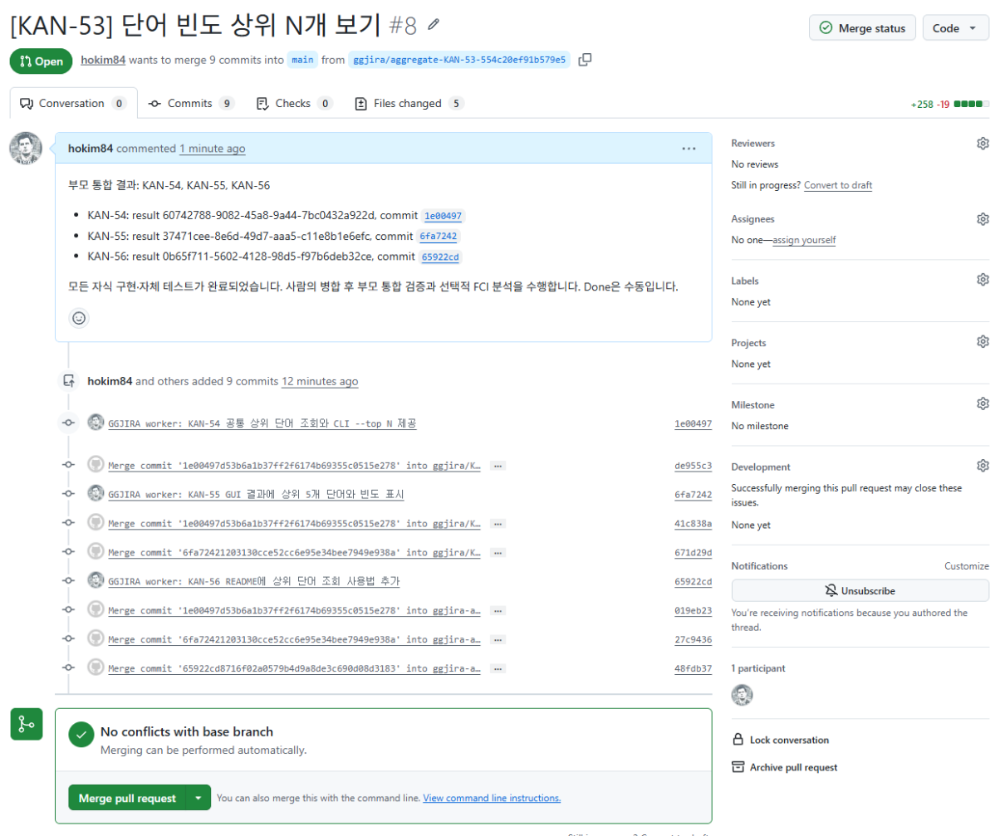

### 9단계. 통합 검증 — 자동

PR이 병합되면 GGJIRA가 병합된 커밋으로 검증 명령을 다시 실행한다(통합 검증). 통과하면 "검증: 통과" 댓글이
달리고 부모가 **AI 구현 완료**로 바뀐다. 실패하면 부모에 `ggjira-failed` 라벨과 실패 댓글이 남고, 댓글 끝에 다음에
할 일이 적힌다([실패했을 때](#실패했을-때)).

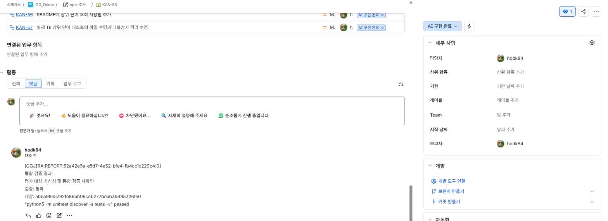

GGJIRA는 GitHub를 주기적으로 확인한다(기본 5분). 병합 직후 바로 바뀌지 않아도 기다리면 된다.

> 이번 실행에서는 첫 PR(#8)의 통합 검증이 **실패**했다. 그 뒤 재계획으로 고치고 두 번째 PR(#9)에서 통과했다.
> 그 과정은 [실제 사례: 통합 검증 실패에서 복구하기](#실제-사례-통합-검증-실패에서-복구하기)에 있다.

### 10단계. Done으로 옮기기 — 사람

부모와 하위 작업이 모두 **AI 구현 완료**가 되면 결과를 확인하고 직접 **Done**으로 옮긴다. 부모와 하위 작업을
각각 옮긴다. GGJIRA는 Done으로 옮기지 않는다. Done으로 옮긴 이슈의 확인 필요 항목(결과 주의사항 등)은 다음 보완
조회 때 대시보드에서 정리된다.

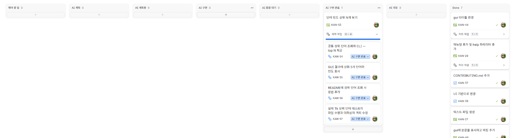

## 다른 상황

### 간단한 작업은 계획 없이 바로

오타 수정처럼 나눌 것이 없는 작업은 **AI 계획**을 건너뛰고 처음부터 **AI 구현**으로 옮긴다. AI는 제목과
설명을 계약으로 삼아 바로 구현한다. 하위 작업이 없으므로 그 이슈에 PR을 만들고 **AI 통합 대기**로 간다.
그다음은 8단계부터 같다.

### AI가 질문할 때

요구사항이 모호하면 AI가 계획 대신 번호 붙은 선택지로 질문하고, 이슈에 `ggjira-needs-answer` 라벨이 붙는다.

```text
1. 대소문자를 구분하지 않는다
2. 대소문자를 구분한다
```

**담당자**가 고른 번호만 댓글로 남긴다(`2` 또는 `2번`). 상태를 다시 옮길 필요는 없다. 첫 유효한 답으로
계획을 다시 세운다. 담당자가 아닌 사람의 댓글, 선택지 밖 번호, 일반 대화는 답으로 보지 않는다.

### 계획을 고치고 싶을 때

- **아직 하위 작업을 승인하기 전:** **AI 계획중**에서 이슈의 제목이나 설명을 고치면 최신 내용으로 다시
  계획한다. 요구사항은 `[GGJIRA:PLAN:START]` 블록 **밖**에 고친다. 블록 안은 GGJIRA가 다시 쓰는 영역이라
  고쳐도 계획이 바뀌지 않는다.
- **처음부터 다시 나누고 싶을 때:** 부모를 **AI 계획**으로 옮긴다.
- **하위 작업을 이미 실행한 뒤 부모 요구사항을 바꿨을 때:** 실행 중인 작업이 끝난 뒤 담당자가 `재계획`
  댓글을 남긴다. 이미 시작했거나 끝난 하위 작업은 보존한다.

### 결과가 마음에 들지 않을 때

고칠 하위 작업의 설명을 고친 뒤 **AI 구현**으로 다시 옮긴다. 그 하위 작업만 다시 구현하고, 다른 하위 작업은
다시 실행하지 않는다. 아직 병합하지 않은 부모 PR은 새 결과로 갱신된다. 이미 병합했다면 새 PR이 만들어진다.

### 실패했을 때

실패하면 이슈에 `ggjira-failed` 라벨과 실패 이유 댓글이 달린다. 원인을 해결한 뒤 **담당자**가 댓글 전체를
`재시도` 한 단어로 남긴다. 실패한 단계(계획, 구현, PR 생성, 통합 검증)만 다시 실행한다. 문장 속에 '재시도'가
들어 있는 일반 댓글로는 다시 실행하지 않는다.

워커 연결이 끊겨 실행 결과가 불확실해지면 GGJIRA는 같은 작업을 저절로 다시 실행하지 않고 안내 댓글을 단다.
워커 머신에서 작업이 멈춘 것을 확인한 뒤 담당자가 `재시도` 댓글을 남긴다.

`재시도`는 **같은 입력으로 다시 실행**한다. 코드에 원인이 있으면 다시 실행해도 같은 결과가 나온다. 그때는
아래 사례처럼 원인을 설명에 적고 **AI 계획**으로 옮겨 고칠 작업을 받는다.

### 실제 사례: 통합 검증 실패에서 복구하기

따라 해 보기의 첫 PR(#8)을 병합하자 통합 검증이 끝나지 않았다. AI가 쓴 GUI 테스트 하나가 임시 파일을 지운 뒤
분석을 다시 실행해 진짜 오류 대화상자를 띄웠고, 누군가 닫아 줄 때까지 기다렸다. AI는 자기 환경에 화면용 Tk가
없어 이 테스트를 건너뛰었고, 하위 작업 단계의 검증에서도 문제가 드러나지 않았다. 당시에는 검증 명령에 따로
제한 시간이 없어 작업 제한 시간(이 Router는 30분)까지 기다려야 했으므로, 워커 머신에서 멈춘 테스트 프로세스를
종료했다. 지금은 검증 명령 제한 시간(기본 10분)에 GGJIRA가 스스로 멈추고 실패로 보고한다.
통합 검증이 실패하자 부모에 `ggjira-failed` 라벨과 "검증: 미통과" 댓글이 달렸다(댓글에는 검증 명령의 출력이
함께 붙는다).

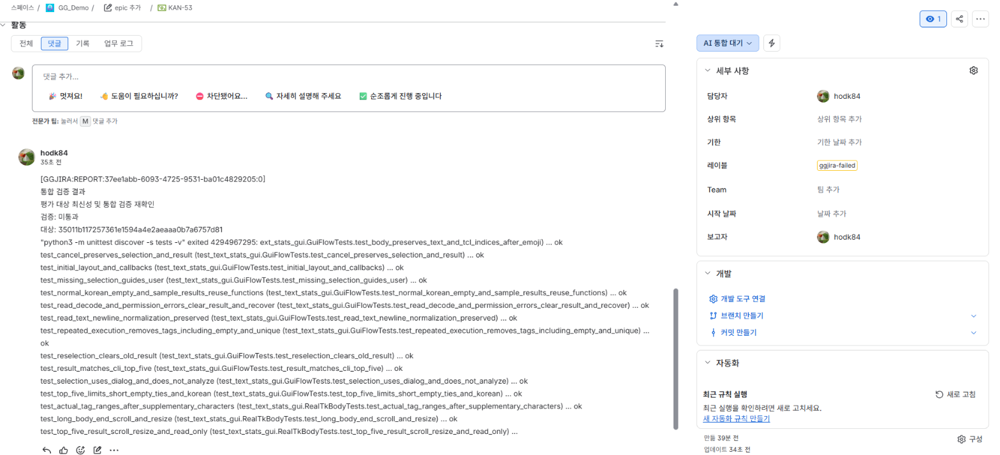

이미 병합된 커밋이 원인이라 `재시도`로는 해결되지 않는다. 그래서 다음처럼 했다.

1. 부모 설명(계획 블록 밖)에 원인과 바라는 결과를 한 문단 덧붙였다. "실제 Tk 화면이 있는 환경에서 테스트가
   오류 대화상자를 띄우고 멈춘다. 대화상자를 띄우지 않고 끝나도록 고친다."
2. 부모를 **AI 계획**으로 옮겼다. AI는 끝난 하위 작업 세 개를 그대로 두고 고칠 하위 작업 KAN-57 하나만 추가했다.

   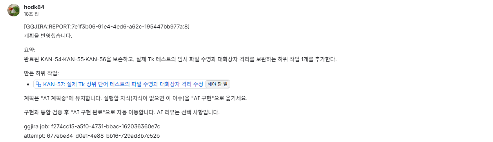

3. KAN-57을 **AI 구현**으로 옮겼다. 구현이 끝나자 새 부모 PR(#9)이 만들어졌다. 첫 PR은 이미 병합됐으므로
   기존 PR을 고치지 않고 새 PR을 만든다.
4. PR #9를 병합하자 통합 검증이 통과하고 부모가 **AI 구현 완료**로 갔다.

### 아무 일도 일어나지 않을 때

Router 웹 UI의 대시보드에서 **다른 작업 찾기**에 이슈 키를 넣고 **작업 상세**를 연다. 대기 이유와 다음 할 일이
나온다. 흔한 원인은 다음과 같다.

- 담당자가 없다 → 담당자를 지정한다. GGJIRA가 한 번 안내 댓글을 단다.
- 워커가 꺼져 있거나 다른 작업 중이다 → 대시보드의 **연결된 워커** 카드를 본다. 괄호 안 "작업 중" 수만큼은 다른
  작업을 하고 있다.
- 앞 하위 작업을 기다린다 → 대시보드에 `대기(조건)`으로 보인다.
- 웹훅이 없다 → 최대 1분 기다린다.

그래도 모르겠으면 관리자에게 [runbook](./runbook.md)의 진단 절차를 부탁한다.

## 알아 두면 좋은 것

- `[GGJIRA:REPORT:…]`로 시작하는 댓글은 Router가 단 것이다. Router의 Jira 계정 이름으로 보인다.
  이 테스트 프로젝트는 사람과 Router가 같은 계정을 써서 모든 댓글이 같은 이름으로 보인다.
- 댓글 끝의 `ggjira job`, `attempt`는 관리자가 기록을 찾을 때 쓰는 번호다.
- 이 테스트 보드에는 지금 쓰지 않는 **AI 리뷰** 열이 남아 있다. 새 보드에는 해야 할 일 → AI 계획 →
  AI 계획중 → AI 구현 → AI 통합 대기 → AI 구현 완료 → Done 순서로 열을 둔다.
- Router 웹 UI의 **사용 가이드** 메뉴에도 이 흐름이 요약되어 있다.
